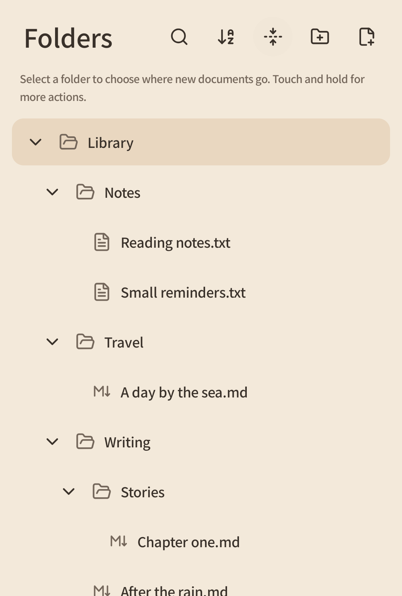
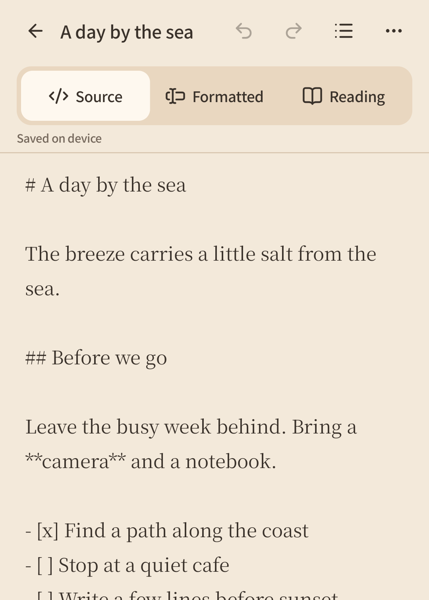
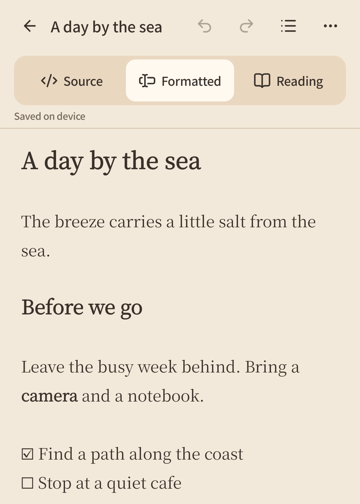
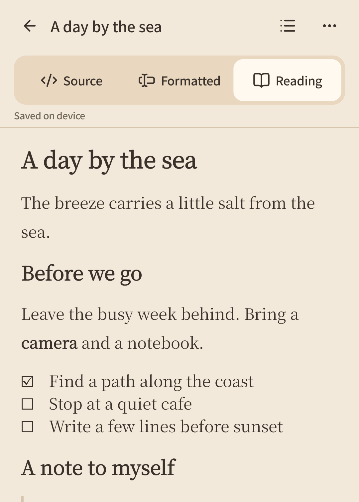
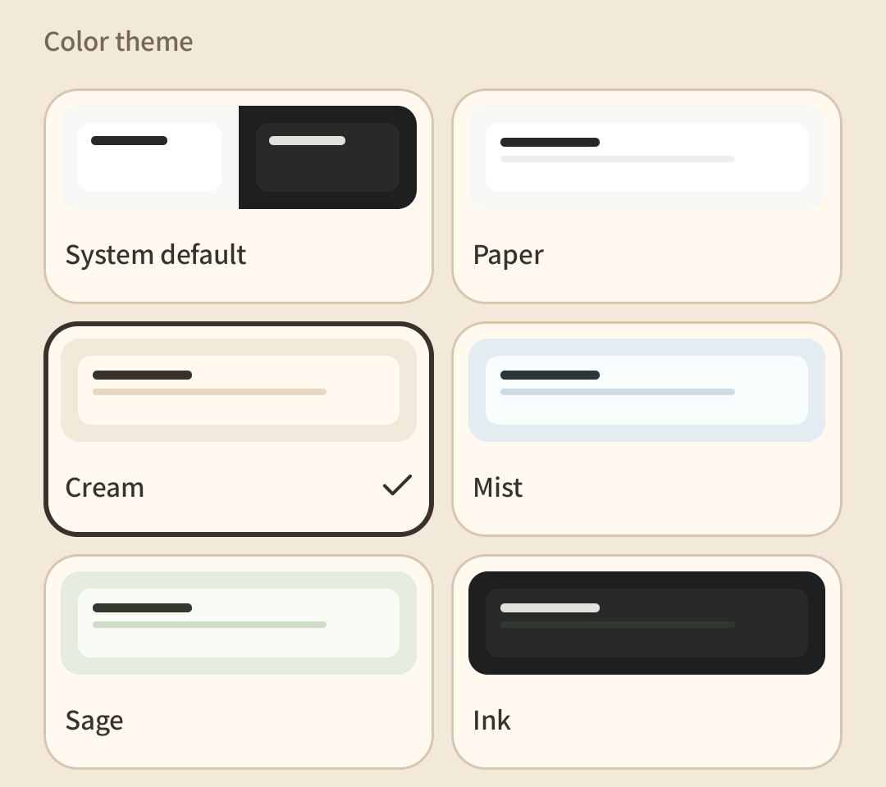

Read this in other languages: [简体中文](README.md) · **English**

<br>
<div align="center">
  
</div>

<h1 align="center">
  
  
</h1>

Makudon is a lightweight, local-first Markdown and plain text editor for reminders, study notes, travel journals, and stories that take a little longer to tell. A soft interface, full folder management, and convenient Markdown editing help you stay with your words.

**No account required. Works offline.** There are no ads, telemetry, or built-in cloud sync. Take your writing with you as ordinary text files or ZIP archives.

[Install](#install) · [Get started](#get-started) · [Backup and restore](#backup-and-restore) · [Build from source](#build-from-source) · [Report an issue](https://github.com/Xrisium/makudon/issues)

> The app is still in development. Try it outside your production workflow first, and export ZIP backups promptly.

## Install

**Requires Android 8.0 or later (API 26+).**

### Download a development APK

1. Open [GitHub Actions · Android checks](https://github.com/Xrisium/makudon/actions/workflows/android.yml) and select a successful run on the branch you want to try.
2. Under **Artifacts** at the bottom of the page, download `makudon-debug-<commit>`, extract it, and find `app-debug.apk`. Downloads require a GitHub account. Artifacts are kept for 7 days; if they have expired, [build from source](#build-from-source).
3. Transfer the APK to your phone and open it to install. When prompted, allow your file manager or browser to install apps.
4. Open **Makudon Dev** and start writing.

Debug signing keys may differ between build environments. If an update reports a signature conflict, export a ZIP backup from the installed version first. **Uninstalling the app deletes its documents. Make sure you have a backup.**

## Features

- **Three Markdown views**: edit precisely in **Source**, write with live formatting in **Formatted**, and review in **Reading**. Switch instantly without closing and reopening the editor.
- **Convenient Markdown tools**: headings, bold and italic text, lists, tasks, quotes, links, code, and tables. Includes undo/redo, find and replace, and heading navigation.
- **Automatic saving**: documents save automatically to private app storage as you edit.
- **Folder management**: a folder tree, name search, sorting, recently opened documents, and batch copy, cut, and delete for documents and folders.
- **Portable files**: import UTF-8 `.md` and `.txt` files, export source copies, and back up the library as a standard ZIP that preserves folders. Extract and edit it on a PC, or use the ZIP to restore a backup.
- **A separate recycle bin**: preview and restore deleted documents and folders. Items do not expire automatically, so accidental deletions can still be found later.
- **Reading your way**: five color themes, including light and dark options, with system theme support; separate interface and document fonts and weights; and document text size you can change while editing.

## Get started

### Create and edit documents

On **Recent**, tap **＋** in the top-right corner and choose **Plain text** or **Markdown**. New documents go in the library root by default. To write in a particular folder, select it on **Folders** before creating a document.

Your text saves automatically as you edit. Tap the document title at the top of the editor to rename it.

### Manage folders

Use **Folders** to organize your entire library in a simple folder hierarchy.

Choose from several sort options, create and delete documents and folders, expand or collapse the tree, and search documents and folders by name.

Touch and hold a document or folder to open its action menu for cut, copy, paste, delete, and details. You can also select multiple items to copy, cut, paste, or delete them together.

<p align="center">
  
</p>

### Write Markdown

Switch between the three views at the top of the Markdown editor:

| View | How to use it |
| --- | --- |
| **Source** | Edit Markdown syntax directly for precise control over markup and table structure. |
| **Formatted** | See formatting as you write. Relevant markup appears where you edit; tap table headers or cells to edit them directly. |
| **Reading** | Review without editing. Select and copy text or search within the document. |

<p align="center">
  
  
  
</p>

Use Markdown shortcuts in the bottom toolbar, grouped under **Text / Paragraph / Insert**. Tap a group to switch or collapse it; with the keyboard open, you can also swipe the toolbar sideways to switch groups.

Use **Outline** at the top right to jump to a section heading. The more menu contains find and replace, text size, and export actions.

Supported Markdown includes H1–H6, nested lists, task lists, quotes, links, code blocks, strikethrough, and tables. Images and HTML are preserved as source but are not rendered. In the formatted view, tables support editing cell contents; use Source to change rows and columns.

### Import and export individual documents

- **Import**: choose **Import** on the new-document screen and select a file. You can also choose Makudon from the system file manager’s “Open with” menu, where supported by your Android device.
- **Export**: use the editor’s more menu to export a copy: `.md` for Markdown or `.txt` for plain text. Choose a save location or open it with another app.

Each document must be UTF-8, with at most 100,000 Unicode code points and an encoded size of no more than 1 MiB. When sharing to another app, finish saving there; opening the share sheet does not mean a backup has been saved.

### Adjust appearance and language

Open **Settings** to choose a color theme and separate interface and document fonts. Noto Sans SC, Noto Serif SC, and LXGW WenKai are included, or you can use your phone’s system font. All fonts work offline, with three weight options.

The editor’s more menu offers three document **Text size** settings: S / M / L.

The app currently supports Simplified Chinese and English. Under **Settings → Language**, choose **System default / 简体中文 / English**.

<p align="center">
  
</p>

## Backup and restore

**Documents live in private app storage. Uninstalling the app or clearing its data deletes them.** Automatic saving, the recycle bin, and local restore snapshots do not replace an external backup.

Open **Settings → Backup and restore**, export the library as a ZIP, and save it outside the app. The archive contains ordinary folders and UTF-8 `.md` / `.txt` files you can extract, read, and edit on a PC. You can also create a ZIP on your PC containing ordinary folders and UTF-8 `.md` / `.txt` files, then import it into Makudon on your Android device.

To restore, select a ZIP from your phone’s storage, review the preview, and confirm a restore mode:

| Mode | When to use it and what happens |
| --- | --- |
| **Restore to a new folder** (default) | Place the archive in a separate folder to inspect a backup or bring in another library. |
| **Update existing library** | Compare by path. Identical text is skipped; for different text, choose Keep local, Use backup, or Keep both. Local-only content is preserved. |
| **Replace entire library** | Replace the whole library with the ZIP contents, removing all existing documents and folder structure. A second confirmation is required. |

The library from before the latest restore is kept as a local snapshot. Choose **Undo last restore** on the same page to switch back; edits made after restoring become part of the new snapshot.

ZIP backups contain current documents and folders only: **no recycle bin, document history, or app settings**. They do not automatically sync devices. To recover an accidental deletion, open **Settings → Recycle bin** and preview or restore the item. Emptying the bin or permanently deleting an item removes the ability to recover it from the bin.

## Build from source

Makudon uses **Kotlin + Jetpack Compose** in a single `:app` module. You need **JDK 17**, the Android SDK (Platform 36 / Build Tools 36.0.0), and Git. The repository includes the Gradle Wrapper.

```sh
git clone https://github.com/Xrisium/makudon.git
cd makudon
```

### Windows / PowerShell 7

Point setup at your existing SDK and JDK (the paths below are examples), then check the environment and run the build, unit tests, and lint:

```powershell
pwsh -NoProfile -File scripts/android.ps1 -Action Setup -SdkPath 'D:\Android\Sdk' -JdkPath 'D:\Java\jdk-17'
pwsh -NoProfile -File scripts/android.ps1 -Action Doctor
pwsh -NoProfile -File scripts/android.ps1 -Action Check
```

`Setup` generates local configuration only; it does not install tools. You can also open `scripts/test-android.cmd` for the Chinese build and debugging menu.

### Use the Gradle Wrapper directly

On other systems, point `JAVA_HOME` at JDK 17 and configure the Android SDK through `ANDROID_HOME` or `sdk.dir` in `local.properties`.

```sh
./gradlew :app:assembleDebug :app:testDebugUnitTest :app:lintDebug
```

In Windows PowerShell, use `./gradlew.bat` instead. The APK is written to `app/build/outputs/apk/debug/app-debug.apk`. See the [development guide](docs/development.md) (Chinese) for configuration, emulator, and VS Code instructions.

## Feedback and contributions

[Open an issue](https://github.com/Xrisium/makudon/issues) to report a bug or suggest an improvement. Include the app version, Android version, device model, and steps to reproduce. Use a shareable sample document when reporting text-related problems.

Developer resources (Chinese unless noted): [Documentation index](docs/README.md) · [Validation status](docs/status.md) · [Architecture](docs/architecture.md) · [Translation contribution guide (English)](docs/localization/CONTRIBUTING.en.md)

## License

Project code is licensed under [MIT](LICENSE). Fonts, icons, and third-party dependencies retain their own licenses; see [Third-party notices](THIRD_PARTY_NOTICES.md). Notices are also available offline under **Settings → Open-source licenses and credits**.
