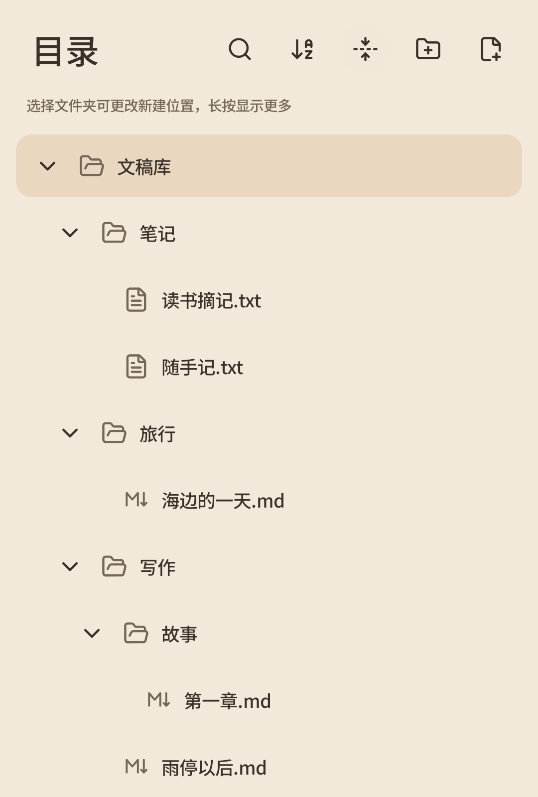
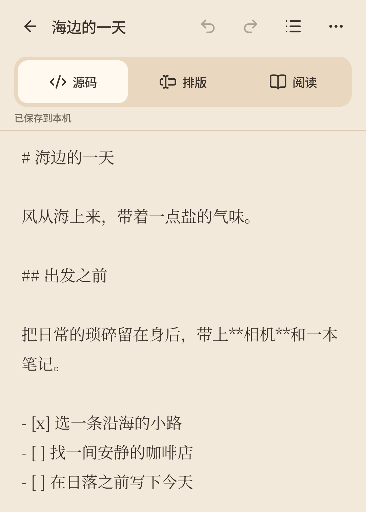
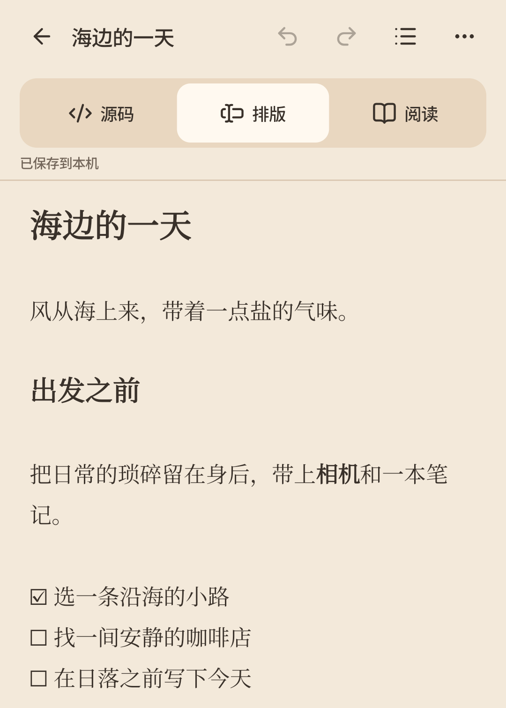
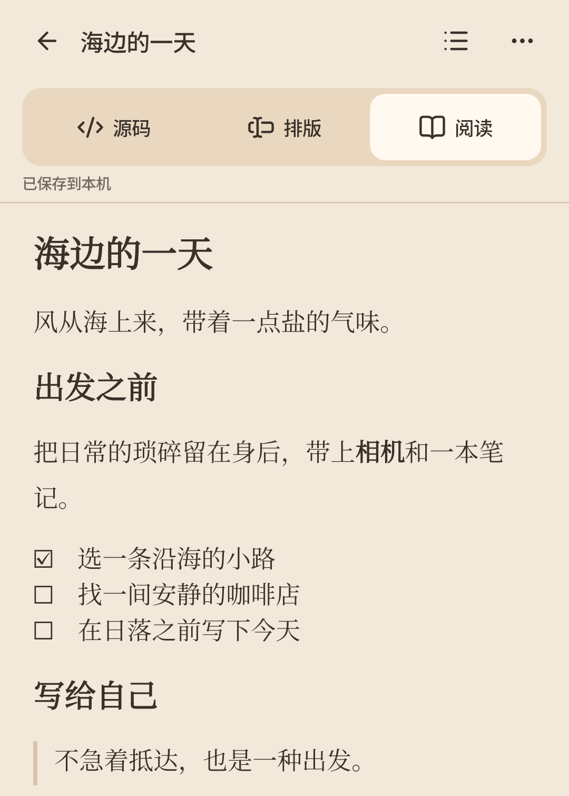
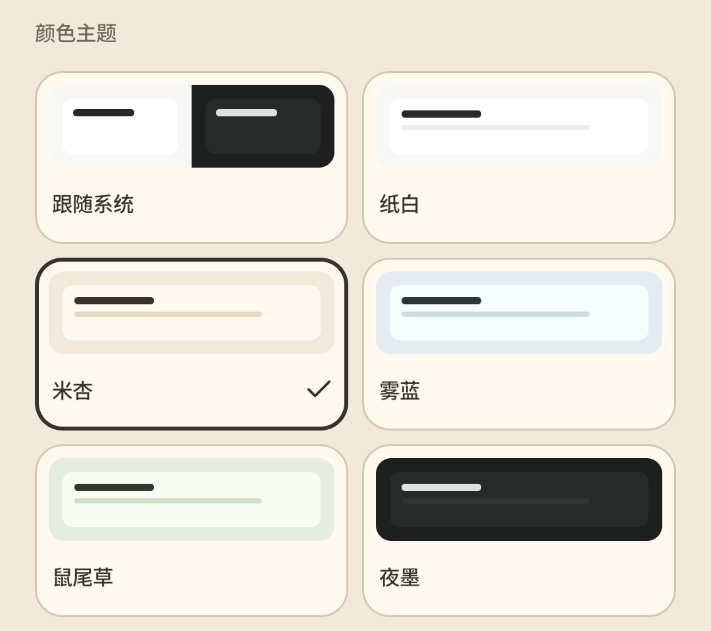

阅读其他语言版本：**简体中文** · [English](README.en-US.md)

<br>
<div align="center">
  
</div>

<h1 align="center">
  
  
</h1>

Makudon 是一款本地优先、轻量化的 Markdown / 纯文本编辑器，适合随手备忘、知识笔记或旅行日记，也适合慢慢写完一篇故事。柔和的界面、完善的目录管理和便捷的 Markdown 编辑支持，让注意力回到文字本身。

**无需账户，离线可用。** 没有广告、遥测或内置云同步，文稿通过普通文本文件和 ZIP 文件自由带走。

[安装](#安装) · [快速上手](#快速上手) · [备份与恢复](#备份与恢复) · [从源码构建](#从源码构建) · [反馈问题](https://github.com/Xrisium/makudon/issues)

> 应用目前仍在开发中，建议先在非生产环境中试用，并即时导出 ZIP 备份。

## 安装

**系统要求：Android 8.0 及以上（API 26+）。**

### 下载开发版 APK

1. 打开 [GitHub Actions · Android checks](https://github.com/Xrisium/makudon/actions/workflows/android.yml)，选择目标分支上一次成功的构建。
2. 在页面底部的 **Artifacts** 中下载 `makudon-debug-<commit>` 压缩包，解压后找到 `app-debug.apk`。下载需要登录 GitHub，构建产物保留 7 天；若已过期，可[从源码构建](#从源码构建)。
3. 将 APK 传到手机，点击安装；按系统提示允许当前文件管理器或浏览器安装应用。
4. 打开 **Makudon Dev**，即可开始写作。

开发包的调试签名可能因构建环境而异。若更新时提示签名冲突，先在旧版中导出 ZIP 备份；请注意，直接卸载会删除应用内文稿！请务必做好备份。

## 功能特色

- **Markdown 三视图**：在**源码视图**中精确修改，在**排版视图**中边写边看，在**阅读视图**中专心审阅。视图之间支持热切换，无需退出编辑再重新打开。
- **顺手的 Markdown 编辑工具**：标题、粗斜体、列表、任务、引用、链接、代码和表格；支持撤销 / 重做、查找替换和标题大纲跳转。
- **自动保存**：编辑过程中，文稿随时自动保存到应用私有目录。
- **文稿目录整理**：支持文件夹树、名称搜索、排序、最近打开记录，以及文稿 / 文件夹的批量复制、剪切和删除。
- **可带走的文件**：导入 UTF-8 `.md` / `.txt`，导出原文副本；用普通 ZIP 备份整个文稿库，保留目录结构。可在 PC 设备解压重新编辑，也可以使用 ZIP 文件恢复备份。
- **独立回收站**：删除的文稿和文件夹可预览、恢复；回收站内容不会自动过期，以防难以发现的误删。
- **按自己的习惯阅读**：五种主题配色，包含深 / 浅色主题，可跟随系统；界面 / 正文独立字体与粗细设置；正文字号可在编辑中随时切换。

## 快速上手

### 文稿新建与编辑

在 **最近** 页点击右上角 **＋**，选择 **纯文本** 或 **Markdown**。新稿默认放在文稿库根目录；如果希望在某个特定文件夹中创建文稿，则需要到 **目录** 页选中对应文件夹并新建文稿。

正文会随编辑随时自动保存。点击编辑页顶部的文稿名可以重命名。

### 目录管理

你可以在 **目录** 页进行对整个文稿库的简单多级目录管理。

支持多种排序方式、新建和删除文件和文件夹、快速展开 / 收起、以及按名称搜索文件和文件夹。

长按文件或文件夹条目可进入文件管理工具菜单，以剪切、复制、粘贴、删除、查看详细信息，或者使用多选，批量复制、剪切、粘贴或删除。

<p align="center">
  
</p>

### 写 Markdown

Markdown 编辑界面顶部可以随时切换三种视图：

| 视图 | 使用方式 |
| --- | --- |
| **源码** | 直接编辑 Markdown 标记，适合精确调整语法与表格结构。 |
| **排版** | 一边编辑一边实时查看排版效果，编辑位置显露相关标记；表头和单元格可直接点击输入。 |
| **阅读** | 只读审阅，支持选择复制和查找，避免误改正文。 |

<p align="center">
  
  
  
</p>

可以在底部工具栏使用 Markdown 快捷编辑工具。工具按 **文本 / 段落 / 插入** 分组；点击入口切组或收起，输入法键盘弹出时也可左右滑动工具栏切组。

右上角的 **大纲** 可按章节标题跳转，更多菜单中可查找替换、调整正文大小或导出副本。

目前支持常用 Markdown，包括 H1–H6、嵌套列表、任务列表、引用、链接、代码块、删除线与表格。图片和 HTML 暂不渲染，原始内容会保留；表格在渲染页面仅支持编辑单元格内容，表格行列结构请在源码视图调整。

### 单文稿导入与导出

- **导入**：从新建页选择 **导入**，再选择文件；也可在系统文件管理器中通过“打开方式”选择 Makudon，是否显示取决于 Android 设备本身是否支持。
- **导出**：在编辑页的更多菜单中导出副本，Markdown 保存为 `.md`，纯文本保存为 `.txt`。可选择保存位置或以其他应用打开。

单篇文稿须为 UTF-8，最多 10 万个 Unicode 码点，且编码后不超过 1 MiB。分享给其他应用后，请在接收应用中完成保存；发起分享不代表文件已经备份。

### 调整外观与语言

打开 **设置**，选择主题配色、界面字体和正文字体。应用内置 Noto Sans SC、Noto Serif SC、霞鹜文楷，也可以使用手机系统字体；字重粗细三档可调，所有字体均可离线使用。

文稿编辑页更多菜单中的 **正文大小** 提供小 / 中 / 大三档正文字号调整。

应用目前已支持简体中文和英文，可在 **设置 → 语言** 中选择 **跟随系统 / 简体中文 / English**。

<p align="center">
  
</p>

## 备份与恢复

**文稿保存在应用私有空间；卸载应用或清除应用数据会删除它们。** 自动保存、回收站和本地恢复快照都不能代替外部备份。

在 **设置 → 备份与恢复** 中导出整库 ZIP，并将它保存到应用之外的位置。ZIP 内是普通文件夹和 UTF-8 `.md` / `.txt` 文件，可在 PC 上正常解压、阅读和编辑。你也可以将在 PC 上创建的、包含普通文件夹和 UTF-8 `.md` / `.txt` 文件的 ZIP 导入回 Android 设备上的 Makudon。

恢复时，需要从手机存储目录选择 ZIP，查看预览后确认恢复方式：

| 恢复方式 | 适用情形与行为 |
| --- | --- |
| **单独保存**（默认） | 将 ZIP 内容放入独立文件夹，适合先检查备份或导入另一份文稿库。 |
| **增量更新** | 按路径比较；相同正文跳过，不同正文逐项选择保留本地、采用备份或保留双方。本地独有内容保留。 |
| **完全覆盖** | 用 ZIP 内容完全覆盖替换当前文稿库，会删除所有的现有文稿和目录结构，执行前需二次确认。 |

最近一次恢复前的文稿库会保留为本地快照，可在同一页面 **撤回上次恢复**；恢复后的编辑会切换为新快照。

ZIP 只包含当前文稿与目录，**不包含回收站、历史版本或应用设置**，也不会自动同步设备。误删文稿请到 **设置 → 回收站** 预览并恢复；清空回收站或彻底删除后，无法再从回收站找回。

## 从源码构建

项目使用 **Kotlin + Jetpack Compose**，单个 `:app` 模块。构建需要 **JDK 17**、Android SDK（Platform 36 / Build Tools 36.0.0）和 Git；Gradle 由仓库内 Wrapper 提供。

```powershell
git clone https://github.com/Xrisium/makudon.git
cd makudon
```

### Windows / PowerShell 7

将已有 SDK 和 JDK 路径（以下路径仅供示例）填入初始化命令，再检查环境、执行构建与检查：

```powershell
pwsh -NoProfile -File scripts/android.ps1 -Action Setup -SdkPath 'D:\Android\Sdk' -JdkPath 'D:\Java\jdk-17'
pwsh -NoProfile -File scripts/android.ps1 -Action Doctor
pwsh -NoProfile -File scripts/android.ps1 -Action Check
```

`Setup` 只生成本地配置，不下载安装工具。日常也可双击 `scripts/test-android.cmd` 打开中文构建与调试菜单。

### 直接使用 Gradle Wrapper

其他环境请先让 `JAVA_HOME` 指向 JDK 17，并配置 Android SDK 路径（`ANDROID_HOME` 或 `local.properties` 中的 `sdk.dir`）。

```sh
./gradlew :app:assembleDebug :app:testDebugUnitTest :app:lintDebug
```

Windows PowerShell 中可改用 `./gradlew.bat`。生成的 APK 位于 `app/build/outputs/apk/debug/app-debug.apk`。详细配置、模拟器与 VS Code 用法见[开发指南](docs/development.md)。

## 反馈与参与

欢迎通过 [Issues](https://github.com/Xrisium/makudon/issues) 报告问题或提出建议。请附上应用版本、Android 版本、设备型号和复现步骤；涉及文稿时，优先使用便于公开的示例内容。

开发资料：[文档索引](docs/README.md) · [验证状态](docs/status.md) · [架构](docs/architecture.md) · [翻译贡献指南（英文）](docs/localization/CONTRIBUTING.en.md)

## 许可证

项目代码采用 [MIT 许可证](LICENSE)。字体、图标与第三方依赖保留各自许可，详见 [第三方声明](THIRD_PARTY_NOTICES.md)；应用内 **设置 → 开源许可与素材致谢** 也可离线查阅。
